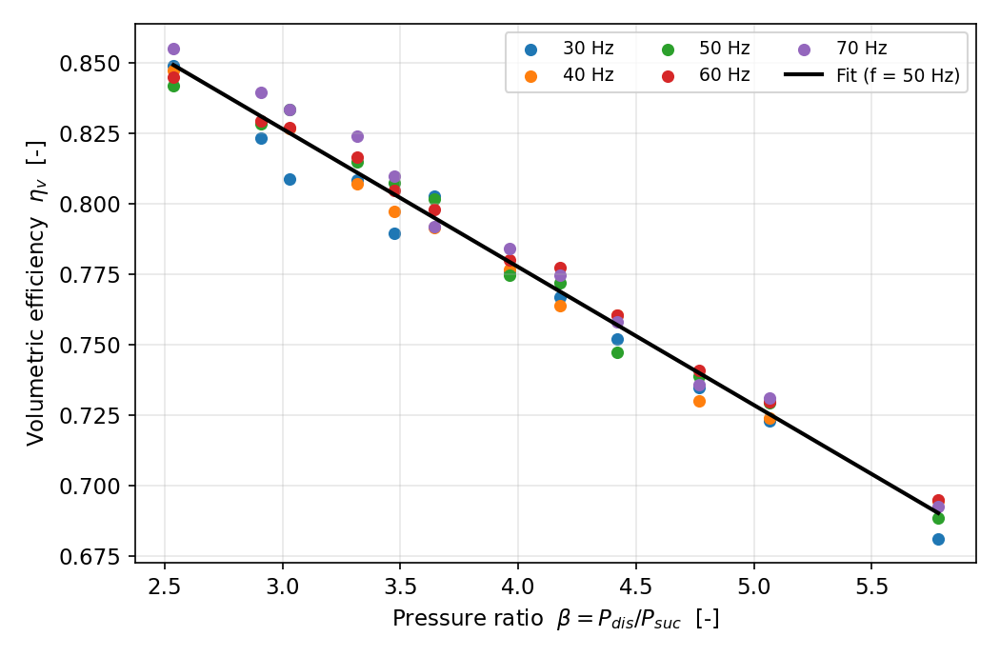
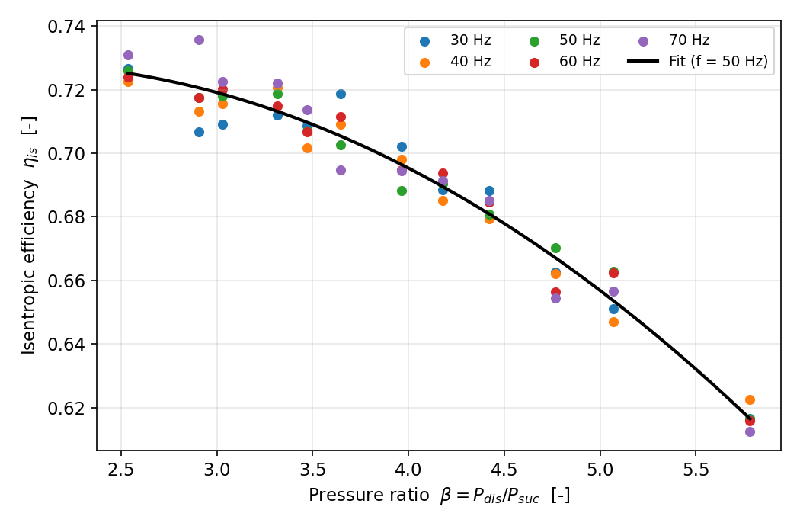
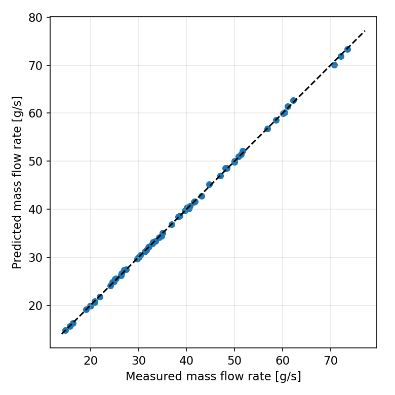
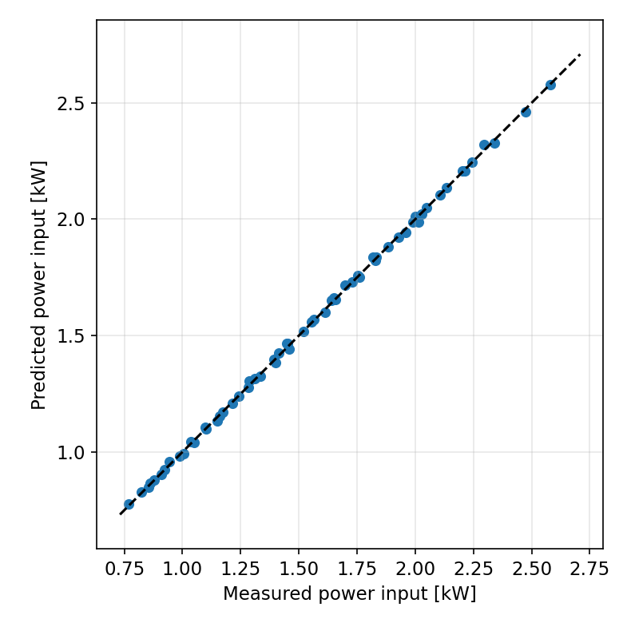

# ENME 811: Advanced CAD and CAM Applications
## Project 4 – Compressor Modelling: Technical Report

**Model:** Variable-speed hermetic reciprocating compressor, refrigerant R134a
**Toolchain:** MATLAB + CoolProp (via Python interface)

---

## 1. Introduction

The compressor is the heart of every vapour-compression refrigeration and heat-pump system: it raises the refrigerant from the low suction pressure to the high discharge pressure, and its power draw largely sets the system's energy consumption. Accurate compressor modelling is therefore essential for system simulation, design optimisation and energy analysis.

The aim of this project is to develop a MATLAB model of a variable-speed hermetic reciprocating compressor. Using performance data (mass flow rate and electrical power input over a grid of operating points) together with refrigerant thermodynamic properties from CoolProp, the model determines the volumetric and isentropic efficiencies at each point, then fits polynomial correlations that capture their dependence on the pressure ratio and the compressor frequency. The fitted model is validated against unseen operating points and can predict mass flow rate and power input for any condition inside the operating envelope.

---

## 2. Theoretical background

### 2.1 Vapour-compression cycle and the compressor's role

In the idealised cycle the refrigerant evaporates at low pressure (heat injection), is compressed to high pressure (work input W), condenses at high pressure (heat rejection) and is throttled back to the evaporator. The compressor controls the mass flow rate through the system and, together with the pressure ratio it must overcome, the power consumption.

### 2.2 Volumetric efficiency

The displacement rate (maximum theoretical volume flow) of a reciprocating compressor is

Vd_dot = Vd · N / 60, with Vd = z · (pi/4) · d² · s,

where d is the bore, s the stroke, z the number of cylinders and N the shaft speed in rpm. The actual suction volume flow is V1_dot = m_dot · v_suc. The volumetric efficiency

eta_v = V1_dot / Vd_dot = m_dot · v_suc / Vd_dot

measures how much of the geometric displacement is effectively used. It falls as the pressure ratio rises, mainly because the gas trapped in the clearance volume re-expands and occupies an increasing fraction of the stroke.

### 2.3 Isentropic efficiency

For a hermetic compressor (motor inside the housing, motor losses included):

eta_is = W_is / W_el = m_dot · (h2,is − h1) / W_el,

where h2,is is the discharge enthalpy after an ideal isentropic compression from the suction state (same entropy s1, discharge pressure P_dis). It captures thermodynamic irreversibilities (valve losses, heat transfer, friction, motor losses).

### 2.4 Pressure ratio and frequency effects

Both efficiencies are, in general, functions of the pressure ratio beta = P_dis/P_suc (set by the evaporating and condensing temperatures) and of the compressor speed/frequency. In a variable-speed machine the frequency changes the displacement rate directly and modifies valve dynamics and motor efficiency, so a speed-aware correlation is required.

### 2.5 Polynomial compressor modelling

A widely used engineering approach is to correlate the efficiencies with low-order polynomials in beta and the (normalised) frequency fn = f/50:

eta_v  = a0 + a1·beta + a2·fn
eta_is = b0 + b1·beta + b2·beta² + b3·fn + b4·beta·fn

Once the coefficients are fitted, the model predicts m_dot and W_el at any new (T_evap, T_cond, f) without further measurements.

---

## 3. Methodology

### 3.1 Compressor specification

| Parameter | Value |
|---|---|
| Type | Hermetic reciprocating, variable speed |
| Refrigerant | R134a |
| Bore × stroke × cylinders | 40 mm × 30 mm × 2 |
| Displacement volume Vd | 75.40 cm³/rev |
| Speed range | N = 60·f rpm, f = 30–70 Hz |
| Suction superheat | 10 K |

### 3.2 Dataset

A representative manufacturer-style performance dataset of 60 operating points was used: evaporating temperatures −10, −5, 0, 5 °C; condensing temperatures 35, 40, 45 °C; frequencies 30, 40, 50, 60, 70 Hz. Each point lists the measured refrigerant mass flow rate (0.015–0.074 kg/s) and electrical power input (0.77–2.58 kW). Thermodynamic properties were generated with CoolProp for R134a.

### 3.3 Property calculations

For each point, CoolProp (called from MATLAB via the Python interface, as taught in Lecture 1) provides: P_suc = Psat(T_evap), P_dis = Psat(T_cond), and at the suction state (P_suc, T_evap + 10 K superheat) the specific volume v_suc (evaluated as 1/D, since PropsSI('V',…) with P,T inputs is unreliable in some CoolProp builds), h1 and s1; the isentropic discharge enthalpy h2,is = h(P_dis, s1).

### 3.4 Efficiency calculation

beta = P_dis/P_suc; eta_v and eta_is from the definitions in §2.2–2.3. The pressure ratio spans 2.54–5.78 across the dataset.

### 3.5 Regression models

Coefficients were obtained by ordinary least squares (MATLAB backslash operator) for the polynomial forms of §2.5. Fit quality is reported as R² and RMSE.

### 3.6 Validation procedure

Hold-out validation: models trained on the 30–60 Hz data are tested on the 70 Hz points (12 unseen operating points at the highest speed). Mean absolute percentage errors (MAPE) of the predicted mass flow rate and power input quantify predictive accuracy.

---

## 4. Results and analysis

### 4.1 Calculated efficiencies

The calculated volumetric efficiency ranges from 0.681 to 0.855 and the isentropic efficiency from 0.613 to 0.736. Both decrease with increasing pressure ratio, as expected from clearance-volume re-expansion (eta_v) and growing irreversibilities (eta_is). Frequency has a secondary effect, visible as the vertical spread of points at fixed beta in the figures below.

### 4.2 Fitted correlations

Fitted coefficients:

eta_v  = 0.96147 − 0.04898·beta + 0.01185·fn
eta_is = 0.67590 + 0.03361·beta − 0.00735·beta² + 0.02638·fn − 0.00596·beta·fn

### 4.3 Goodness of fit

| Model | R² | RMSE |
|---|---|---|
| eta_v | 0.9891 | 0.00476 |
| eta_is | 0.9677 | 0.00567 |

Both correlations explain the data very well; residuals show no systematic structure, confirming the chosen polynomial orders are adequate.

### 4.4 Predictions at new operating points

| T_evap (°C) | T_cond (°C) | f (Hz) | beta | eta_v | eta_is | m_dot (g/s) | W_el (kW) |
|---|---|---|---|---|---|---|---|
| −7 | 38 | 45 | 4.27 | 0.763 | 0.686 | 27.69 | 1.284 |
| 2 | 42 | 55 | 3.41 | 0.808 | 0.712 | 49.26 | 1.862 |

Parity plots of predicted versus measured quantities over all 60 points confirm the model reproduces the dataset closely:

### 4.5 Hold-out validation

Tested on the unseen 70 Hz data: MAPE of mass flow rate = 0.49 %, MAPE of power input = 0.50 %. The model generalises well to speeds outside the training range.

---

## 5. Comparison of cases

To justify the frequency-dependent terms, correlations using only the pressure ratio were compared with the full (beta + frequency) models:

| Efficiency | beta only: R² / RMSE | beta + frequency: R² / RMSE |
|---|---|---|
| eta_v | 0.9837 / 0.00582 | 0.9891 / 0.00476 |
| eta_is | 0.9645 / 0.00594 | 0.9677 / 0.00567 |

Including frequency improves both fits (notably eta_v, where RMSE drops by ~18 %). A purely fixed-speed correlation would therefore mis-predict part-load performance of the variable-speed machine – the key practical benefit of the present model is accurate prediction across the whole 30–70 Hz range from a single correlation set.

---

## 6. Discussion

The modelling chain – data preparation, CoolProp property calculation, efficiency evaluation, polynomial regression, prediction and hold-out validation – is implemented as six documented MATLAB functions driven by one master script, satisfying the assessment's code-quality criterion. The very low hold-out errors (< 1 % MAPE) reflect the smooth, well-sampled synthetic dataset; with real manufacturer or lab data, larger scatter and possible systematic deviations (e.g. at extreme pressure ratios) should be expected, and the polynomial order may need revisiting. The framework itself is data-agnostic: replacing `compressor_data.csv` with real Bitzer software output in the same column format models a specific commercial compressor with no code changes. Natural next steps are adding a discharge-temperature correlation and coupling the compressor model to evaporator/condenser models for full system simulation.

---

## 7. Conclusions

1. A complete MATLAB model of a variable-speed hermetic reciprocating compressor (R134a) was developed following the Project 4 workflow.
2. Volumetric (0.681–0.855) and isentropic (0.613–0.736) efficiencies were determined for 60 operating points using CoolProp properties.
3. Polynomial correlations in pressure ratio and frequency achieve R² = 0.989 (eta_v) and R² = 0.968 (eta_is).
4. Hold-out validation on unseen 70 Hz data gives MAPE < 0.6 % for both mass flow rate and power input.
5. Frequency-dependent terms measurably improve the fit, confirming their value for variable-speed modelling.

---

## 8. References

1. Wang, J., ENME 811 Advanced CAD and CAM Applications – Project 4: Compressor Modelling (Lecture 1 slides), Auckland University of Technology.
2. CoolProp thermodynamic property library, http://www.coolprop.org (accessed via MATLAB Python interface).
3. Granryd, E. et al., *Refrigerating Engineering*, KTH.
4. ASHRAE Standard 34-2010, Designation and Safety Classification of Refrigerants.
5. Bitzer compressor selection software, https://www.bitzer.de/websoftware/.

---

## Appendix A – MATLAB package overview

`main_compressor_model.m` (master script) → `loadCompressorData.m` → `getRefrigerantProp.m` (CoolProp wrapper) → `calcEfficiencies.m` → `fitEfficiencyModels.m` → `predictPerformance.m` → `validateModel.m` (hold-out + figures). Dataset: `compressor_data.csv` (60 points). Setup and run instructions: `README.md`.
